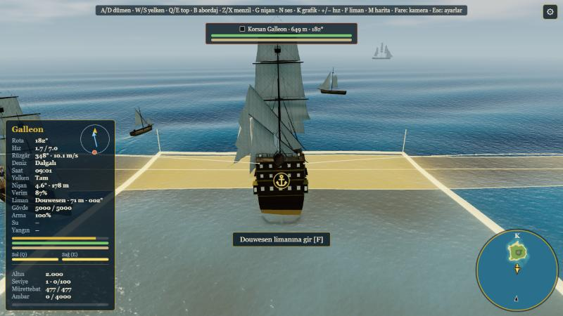
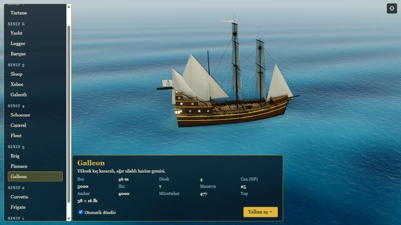

# Ship RPG

[](LICENSE)
[](LICENSE)

A browser-based 3D naval RPG in the spirit of *Pirates of the Caribbean* (2003) / *Sea Dogs*. Three.js + TypeScript (strict) + Vite, no server needed.

**Play now:** https://gkaragoz.github.io/ship-rpg/ (the in-game text is Turkish; code and docs are English)

<p align="center">
  
</p>
<p align="center">
  
</p>

## Features

- **16 ship types** from the Tartane to the Battleship, each a Blender-made GLB with 3 LODs (the procedural ship stays as the fallback), rigging with cloth-animated sails and flags, a walkable deck with a rigged crew.
- **Open-sea sailing:** wind with gusts and a polar diagram, point of sail, waves and weather, day and night, ship buoyancy and crashes.
- **Combat:** broadside cannons with ballistics, aim zones, hit zones (waterline / hull / rigging), leaks, fire, fleeing enemies, boarding and loot. Balanced by a duel simulator (`npm run balance`).
- **Archipelago:** 8 islands and the 11 ports of the original map with fog of war, a minimap and a chart.
- **Economy and RPG:** trade goods between ports, a shipyard (buy, part exchange, repair), crew hiring, captain levels, flags at war with standing, tavern errands, merchant traffic.
- **Saving** to the browser: autosave plus slots, even in the middle of a fight.
- Settings menu (graphics presets, audio, debug overlay with F3).

## Controls

| Key | Action |
|---|---|
| A / D | Rudder |
| W / S | Sail step (furled, half, full) |
| Q / E | Port / starboard broadside |
| Z / X | Lay the guns lower / higher |
| G | Aim zones |
| B | Board a crippled ship |
| F | Dock at a port |
| M | Chart |
| N | Mute |
| + / - | Game speed |
| R | Restart |
| Esc | Menu (pauses, settings, saves) |
| Mouse drag / wheel | Orbit the camera / zoom |

## Development

Prerequisites: Node.js 18+ (22 recommended).

```bash
npm install
npm run dev       # dev server
npm run check     # typecheck + lint + tests
npm run build     # production build into dist/
npm run balance   # duel simulator report
```

The code is split into modules with enforced import directions (`core`, `ships`, `world`, `render`, `gameplay`, `ui`, `audio`, `settings`, `app`). Start with [`docs/ARCHITECTURE.md`](docs/ARCHITECTURE.md); the other docs ([`docs/`](docs)) cover ships, the sea, settings, economy, balance and the Blender pipeline for regenerating the models.

## Publishing

Every push to `main` runs `.github/workflows/deploy.yml` (typecheck, lint, build, deploy to GitHub Pages; the full tests run in `ci.yml` beside it). The build uses a relative `base`, so it also works under a sub-path. One-time setup: repository Settings → Pages → Source: **GitHub Actions**.

## License

This project is **source-available, but closed to commercial use**, under the [PolyForm Noncommercial License 1.0.0](LICENSE) plus additional terms:

- ✅ You may play, read, modify and share it for **noncommercial** purposes (personal use, hobby, education, research, charities, public institutions).
- ❌ You may **not** sell it, monetize it (ads, subscriptions, in-app purchases, paid hosting) or include it in a paid product without written permission.
- 📝 Keep the license and the "© gkaragoz and Contributors" notice; a modified version must be marked as modified and must not pass itself off as the official "Ship RPG".
- Third-party libraries keep their own licenses: [THIRD_PARTY_NOTICES.md](THIRD_PARTY_NOTICES.md).

Open-source licenses such as MIT or the AGPL cannot stop commercial copying, which is why this license was chosen; the project is not "open source" in the OSI sense.
